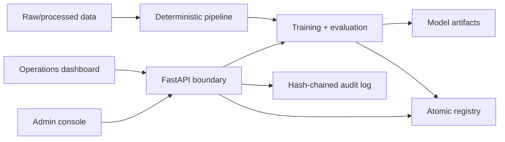

# AIPulse

AIPulse adalah baseline modular untuk lifecycle model klasifikasi tabular: pemrosesan data,
training dan evaluasi, registry artefak, API terautentikasi, audit log, serta dua UI Streamlit.
Implementasi ini ditujukan untuk local development dan sebagai fondasi deployment internal;
bukan klaim sebagai platform enterprise lengkap.

## Kemampuan utama

- Pipeline data deterministik yang mempertahankan label dan menulis Parquet secara atomik.
- Training scikit-learn tanpa data leakage, dengan stratified validation split.
- Metrik klasifikasi yang benar, termasuk AUC dari probability score dan release gate.
- Registry JSON atomik dengan semantic version ordering dan checksum SHA-256 artefak.
- FastAPI dengan JWT validation, role-based access, rate limit, CORS allowlist, dan audit log.
- Fairness, compliance evidence, poisoning, drift, dan inference health checks yang dapat
  mengembalikan `not_assessed` saat bukti tidak tersedia.
- Dashboard read-only dan admin console yang hanya berkomunikasi melalui API.
- Container non-root, health check, resource limit, dan port lokal secara default.

## Arsitektur



Semua komponen saat ini berjalan sebagai modular monolith dengan penyimpanan berbasis file.
Lihat [desain arsitektur](docs/03_architecture_design.md) untuk trade-off dan batasannya.

## Menjalankan secara lokal

Prasyarat: Python 3.11–3.14.

```powershell
py -3.11 -m venv .venv
.venv\Scripts\python.exe -m pip install -e ".[dev]"
Copy-Item .env.example .env
$env:AIPULSE_JWT_SECRET = "ganti-dengan-secret-random-minimal-32-byte"
.venv\Scripts\python.exe -m uvicorn aipulse.system.api_gateway:app --reload
```

Jalankan UI pada terminal terpisah:

```powershell
.venv\Scripts\python.exe -m streamlit run src/frontend/dashboard.py --server.port 8080
.venv\Scripts\python.exe -m streamlit run src/frontend/admin_panel.py --server.port 8081
```

API health tersedia tanpa token di `http://localhost:8000/api/v1/health`. Dokumentasi OpenAPI
tersedia di `/docs` kecuali ketika `AIPULSE_ENV=production`.

## Token development

Tidak ada endpoint yang menerbitkan token. Gunakan identity provider di deployment nyata. Untuk
local development atau test, buat token singkat melalui helper tepercaya:

```powershell
$env:AIPULSE_JWT_SECRET = "secret-yang-sama-dengan-api"
.venv\Scripts\python.exe -c "from aipulse.config import Settings; from aipulse.security.auth import create_access_token; print(create_access_token(Settings.from_env(), 'local-user', ['admin']))"
```

Role yang diterima:

- `viewer`, `data_scientist`, `ml_engineer`, atau `admin` untuk membaca registry.
- `ml_engineer` atau `admin` untuk memulai training.

## Docker Compose

```powershell
$env:AIPULSE_JWT_SECRET = "ganti-dengan-secret-random-minimal-32-byte"
docker compose up --build
```

Service hanya diekspos ke loopback host: API `8000`, dashboard `8080`, dan admin `8081`.
Volume `data/`, `models/`, dan `logs/` bersifat lokal dan diabaikan Git.

## Quality gate

```powershell
.venv\Scripts\python.exe -m ruff check src tests
.venv\Scripts\python.exe -m ruff format --check src tests
.venv\Scripts\python.exe -m mypy
.venv\Scripts\python.exe -m pytest
docker compose config --quiet
docker build -t aipulse:local .
```

## Struktur penting

- `src/core`: training, evaluasi, dan monitoring.
- `src/data_engineering`: pipeline, feature store lokal, dan checksummed snapshots.
- `src/system`: API, registry, dan dependency-aware orchestration.
- `src/security`: auth, audit, fairness, compliance evidence, dan integrity checks.
- `src/frontend`: API client, dashboard, dan admin console.
- `tests`: unit dan API integration tests.

## Batasan produksi

Sebelum penggunaan multi-instance atau internet-facing, tambahkan external OIDC/JWKS, rate limiter
terdistribusi, database transaksional/object storage, job queue terpisah, TLS dari reverse proxy,
centralized observability, backup/restore, serta threat model dan compliance review organisasi.

Detail dependency ada di [tech stack](docs/02_tech_stack.md). Pelaporan kerentanan dijelaskan di
[SECURITY.md](SECURITY.md). Lisensi proyek: [MIT](LICENSE).
