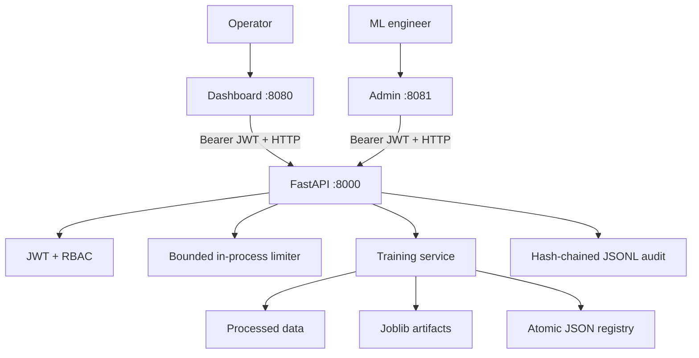

# Desain arsitektur AIPulse

## Bentuk sistem saat ini

AIPulse adalah modular monolith. Satu image dapat menjalankan API atau salah satu UI; ketiganya
berbagi kontrak package dan, melalui volume API, penyimpanan file lokal.

## Boundary dan aliran data

1. Pipeline membaca raw CSV/Parquet, membersihkan data, dan menulis processed Parquet.
2. Endpoint training memvalidasi nama dataset agar tidak keluar dari processed-data directory.
3. Training service membagi dataset sebelum fitting preprocessing dan estimator.
4. Evaluator menghasilkan metrik dan release gate; hasil gagal tetap dapat disimpan sebagai candidate.
5. Artefak ditulis atomik, dihitung SHA-256, lalu metadata ditambahkan ke registry.
6. API menulis outcome ke audit trail dan mengembalikan hasil ke admin console.
7. Dashboard membaca health dan registry hanya melalui API.

## Security boundary

- Health endpoint bersifat publik dan tidak mengungkap secret.
- Endpoint registry memerlukan role baca; training memerlukan `ml_engineer` atau `admin`.
- JWT wajib memuat expiry, issued-at, issuer, audience, dan subject.
- Request model melarang field ekstra dan membatasi pola identifier/path.
- Rate limit dihitung per subject dan endpoint, dengan jumlah principal yang dibatasi.
- CORS hanya aktif untuk origin yang dikonfigurasi.
- Container berjalan sebagai UID/GID non-root dan memakai `no-new-privileges` di Compose.

Audit hash chain mendeteksi modifikasi, tetapi file lokal bukan immutable storage. Untuk kebutuhan
regulator, kirim audit event ke append-only/WORM storage dengan retention dan access control resmi.

## Konsistensi dan concurrency

Registry serta file store memakai lock in-process dan atomic replace. Karena lock tidak
terdistribusi, API sengaja dijalankan dengan satu worker. Multi-worker/multi-replica memerlukan
database dengan transaction/unique constraints dan distributed rate limiter.

Training saat ini sinkron. Dataset besar akan menahan request dan resource API; production harus
memindahkan training ke job queue/worker serta menambahkan idempotency key dan status endpoint.

## Jalur evolusi yang disarankan

1. External OIDC/JWKS dan secret manager dengan key rotation.
2. PostgreSQL untuk registry/jobs dan object storage untuk dataset/model.
3. Queue/worker untuk training, retry policy, cancellation, dan idempotency.
4. OpenTelemetry metrics/traces/logs dan alerting berbasis SLO.
5. Backup/restore drill, artifact signing, SBOM, dan vulnerability scanning.
6. Deployment orchestration hanya setelah kebutuhan scaling terukur.
